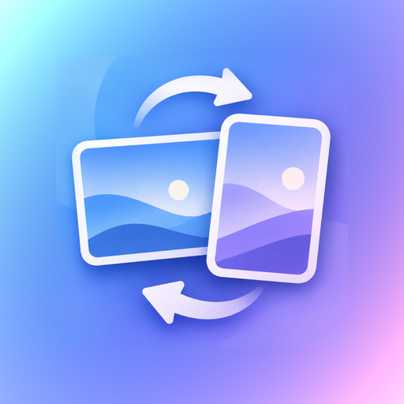

<p align="center">
  
</p>

<h1 align="center">DualWall</h1>

<p align="center">安卓平板上的双方向壁纸工具：横屏与竖屏各用一张图、各有一套裁切位置，应用后不位移、不拉伸、不二次裁切。</p>

<p align="center">
  <a href="https://github.com/Summer-Ever/DualWall/releases/latest"></a>
  
  
</p>

针对联想 ZUI / 类原生系统（ZUI 16 = Android 14）开发，`minSdk 30`，无任何第三方 SDK、不联网。

**直接下载安装** → [Releases](https://github.com/Summer-Ever/DualWall/releases/latest)（下载 `.apk`，允许「未知来源」即可）。

## 为什么是动态壁纸

静态壁纸（`WallpaperManager.setBitmap`）只能交付一张位图，放在哪、裁哪块、允不允许滚动，全由 Launcher 决定，而且**没有任何 API 能探测某个 Launcher 的策略**；同时它的数据模型里没有「屏幕方向」这个维度，做不了横竖各一张。

所以主通道是 `WallpaperService` 动态壁纸，自己绘制、自己决定裁切：

| 能力 | 静态 `setBitmap` | 动态壁纸 |
|---|---|---|
| 精确裁切 | 只能给 `visibleCropHint` 提示，可被无视 | 像素级可控 |
| 零位移 | 取决于 Launcher | 忽略 `onOffsetsChanged` 即恒为 0 |
| 横竖双图 | 无方向维度 | 按 surface 宽高选配方 |
| 锁屏独立图 | 支持 `FLAG_LOCK` | **做不到区分 home/lock** |

因此：**桌面走动态壁纸，锁屏走静态 `FLAG_LOCK`**（能力不支持时自动降级为「锁屏跟随桌面」）。

## 零位移的三个条件

位移的本质是系统对输出图又做了一次 cover 裁切。要让它成为空操作：

1. 输出尺寸 = 目标视口尺寸（`onSurfaceChanged` 给出的 w/h）；
2. 裁切框宽高比**严格等于**视口宽高比 —— 用 `gcd` 求整数比例单元，只取整数倍，不用浮点反推；
3. 两个轴的缩放因子是同一个数（条件 2 成立时自动成立）。

核心实现在 `core` 模块，纯 JVM、无 Android 依赖、可单测：

- `Crop.cropRect()` — 返回源图上的整数裁切框
- `Crop.coverRect()` — 画布落位，比例一致时等于整块画布，不一致时居中裁掉，**永不拉伸**
- `Crop.anchorAfterDrag()` / `anchorAfterZoom()` — 手势换算成归一化锚点，某轴余量为 0 时保持原值

配方只存「原图 + 归一化锚点 + 缩放」，不烘焙位图；apply 时按当时的真实视口重算，换分辨率、进 PC 模式都不会错位。

```json
{
  "portrait":  { "path": "...", "w": 4000, "h": 3000, "ax": 0.5,  "ay": 0.34, "z": 1.0 },
  "landscape": { "path": "...", "w": 5000, "h": 3000, "ax": 0.42, "ay": 0.5,  "z": 1.08 }
}
```

## 工程结构

```
core/   纯 JVM：裁切几何 + 单元测试（15 例）
app/
  data/       Recipe / RecipeStore / ImageStore
  render/     Viewport 探测、合成
  apply/      WallpaperApplier（动态 / 静态双通道 + 视口尺寸校验）
  wallpaper/  DualWallpaperService（引擎）
  ui/         EditorScreen / CropCanvas（Compose）
```

## 构建

需要 JDK 17 与 Android SDK（compileSdk 35）。

```bash
./gradlew :core:test :app:assembleDebug
```

产物：`app/build/outputs/apk/debug/app-debug.apk`

安装：

```bash
adb install -r app/build/outputs/apk/debug/app-debug.apk
```

## 使用

1. 顶部切到「横屏」→ 选图 → 拖动调整构图、双指或滑块缩放；
2. 切到「竖屏」→ 可为竖屏单独选另一张图，裁切独立保存；
3. 「应用到桌面（动态壁纸）」→ 系统确认页 → 设为壁纸；
4. 「单独设置锁屏」按需使用，输出位图严格等于当前视口尺寸；若锁屏仍出现位移，说明系统做了二次裁切。

## 已知限制

- 静态锁屏通道在部分国内 ROM 上会被静默忽略（`FLAG_LOCK` 无效），此时锁屏跟随桌面；
- 若某 Launcher 在 `WallpaperView` 层再做二次缩放，需要 Shizuku / LSPosed 兜底，当前版本未实现；
- 锁屏通道尚无机型全覆盖验证。

## 排查

应用内已内置崩溃自检：异常堆栈写入私有目录，下次启动在顶部以红色横幅显示，可一键复制。
